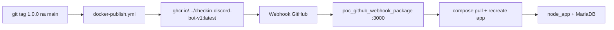

# GitHub Package Webhook — deploy do checkin-discord-bot-v1

Listener Node.js que recebe webhooks **Package** / **registry_package** do GitHub e atualiza o bot na DigitalOcean via `docker compose pull app`.

## Arquitetura



| Repositório | Papel |
|-------------|--------|
| [checkin-discord-bot-v1](https://github.com/Coletivo-Popular-Design-Desenvolvimento/checkin-discord-bot-v1) | App + GHCR publish (`docker-publish.yml`) |
| **poc_github_webhook_package** (este) | Webhook listener na droplet |

## Publicar imagem no GHCR (repo do bot)

No `checkin-discord-bot-v1`, o workflow `.github/workflows/docker-publish.yml` publica quando você cria uma **tag semver** em commit da `main` ou `homol`:

```bash
git tag 1.0.0
git push origin 1.0.0
```

| Branch | Tags publicadas |
|--------|-----------------|
| `main` | `1.0.0` + `latest` |
| `homol` | `1.0.0-homol` + `homol` |

Imagem:

```
ghcr.io/coletivo-popular-design-desenvolvimento/checkin-discord-bot-v1:latest
```

## Webhook no GitHub

Configure em **checkin-discord-bot-v1 → Settings → Webhooks**:

| Campo | Valor |
|-------|--------|
| Payload URL | `https://SEU_DOMINIO/webhook/github` |
| Content type | `application/json` |
| Secret | igual ao `WEBHOOK_SECRET` |
| Events | **Package** ou **Registry packages** |

## Variáveis — webhook listener (`.env`)

```env
WEBHOOK_SECRET=...
PACKAGE_OWNER=Coletivo-Popular-Design-Desenvolvimento
PACKAGE_NAME=checkin-discord-bot-v1
IMAGE_TAG=latest

COMPOSE_CWD=/opt/checkin-discord-bot-v1/deploy
COMPOSE_SERVICE=app
```

| Variável | Descrição |
|----------|-----------|
| `COMPOSE_CWD` | Pasta do `docker-compose.yml` do bot |
| `COMPOSE_SERVICE` | Serviço a atualizar (`app` — só o bot, não o banco) |
| `IMAGE_TAG` | `latest` (prod) ou `homol` (homologação) |

## Setup na DigitalOcean (passo a passo)

### 1. Instalar dependências

```bash
sudo apt update
sudo apt install -y nginx certbot python3-certbot-nginx git
curl -fsSL https://deb.nodesource.com/setup_20.x | sudo -E bash -
sudo apt install -y nodejs docker.io docker-compose-plugin
```

### 2. Clonar o bot e configurar

```bash
sudo mkdir -p /opt/checkin-discord-bot-v1
sudo git clone https://github.com/Coletivo-Popular-Design-Desenvolvimento/checkin-discord-bot-v1.git /opt/checkin-discord-bot-v1

# Secrets do bot (TOKEN_BOT, DB_*, DATABASE_URL)
sudo nano /opt/checkin-discord-bot-v1/.env

# Compose + imagem GHCR
sudo cp /opt/github-webhook/deploy/checkin-discord-bot.compose.yml /opt/checkin-discord-bot-v1/deploy/docker-compose.yml
sudo cp /opt/github-webhook/deploy/checkin-discord-bot.env.example /opt/checkin-discord-bot-v1/deploy/.env
sudo nano /opt/checkin-discord-bot-v1/deploy/.env
```

Primeira subida:

```bash
cd /opt/checkin-discord-bot-v1/deploy
sudo docker compose up -d
```

Package **público** no GHCR: não precisa `docker login`. **Privado:** `echo "$TOKEN" | docker login ghcr.io -u USER --password-stdin`.

### 3. Instalar o webhook listener

```bash
sudo git clone https://github.com/filipehb/poc_github_webhook_package.git /opt/github-webhook
cd /opt/github-webhook
sudo npm ci
sudo cp .env.example .env
sudo nano .env
sudo chmod +x scripts/deploy-container.sh

sudo useradd --system --home /opt/github-webhook --shell /usr/sbin/nologin webhook || true
sudo usermod -aG docker webhook
sudo chown -R webhook:webhook /opt/github-webhook

sudo cp deploy/webhook.service /etc/systemd/system/github-webhook.service
sudo systemctl daemon-reload
sudo systemctl enable --now github-webhook
```

### 4. Nginx + HTTPS

```bash
sudo cp deploy/nginx-site.conf /etc/nginx/sites-available/github-webhook
# Edite server_name
sudo ln -sf /etc/nginx/sites-available/github-webhook /etc/nginx/sites-enabled/
sudo nginx -t && sudo systemctl reload nginx
sudo certbot --nginx -d seu-dominio.com
```

### 5. Testar

```bash
curl https://seu-dominio.com/health
sudo journalctl -u github-webhook -f
```

Publique uma tag no bot → webhook → logs devem mostrar `Triggering deploy for ghcr.io/.../checkin-discord-bot-v1:latest`.

## Desenvolvimento local

```bash
npm install
cp .env.example .env
npm start
ngrok http 3000
```

## Estrutura deste repo

```
src/                          Webhook listener Node.js
scripts/deploy-container.sh   pull + compose recreate (servico app)
deploy/
  webhook.service             systemd
  nginx-site.conf             reverse proxy
  checkin-discord-bot.compose.yml   template compose prod (bot + db)
  checkin-discord-bot.env.example   template deploy/.env (DOCKER_IMAGE)
```
